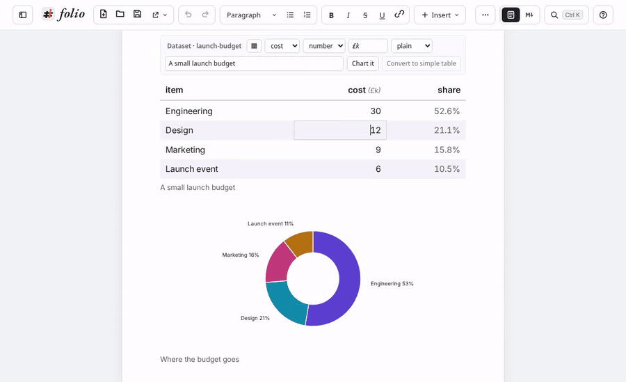
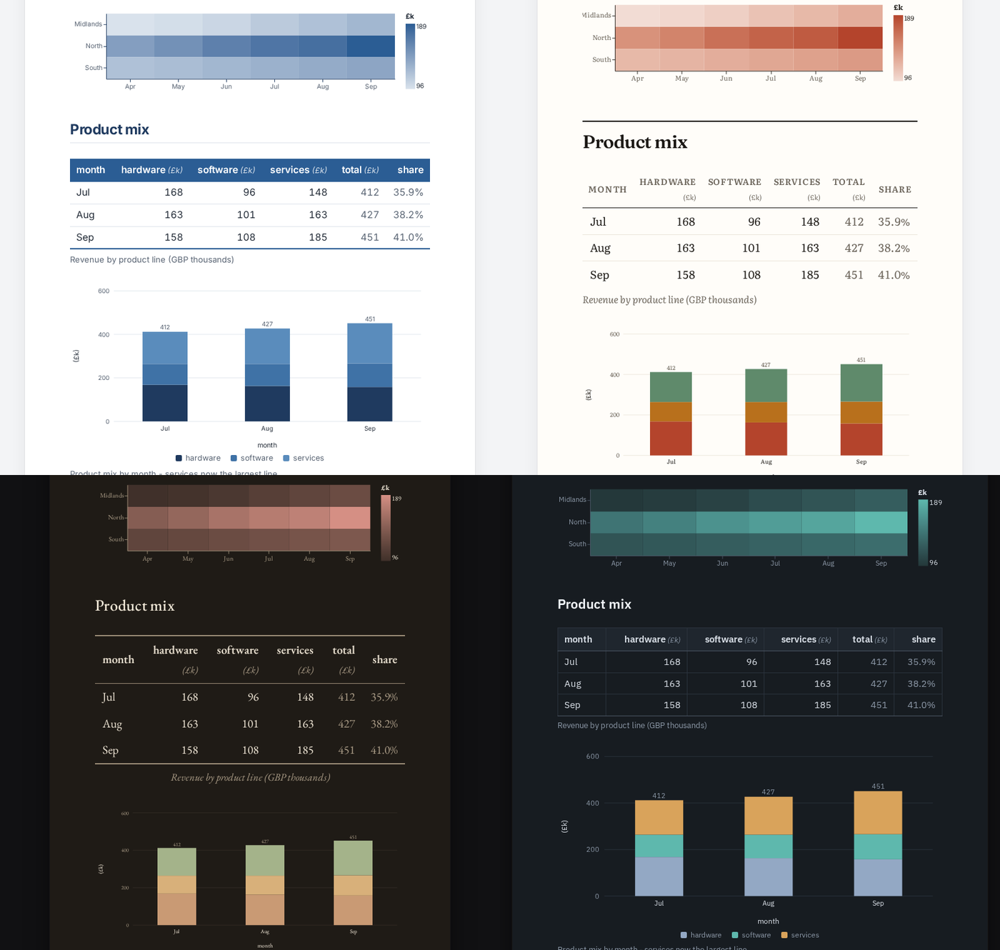
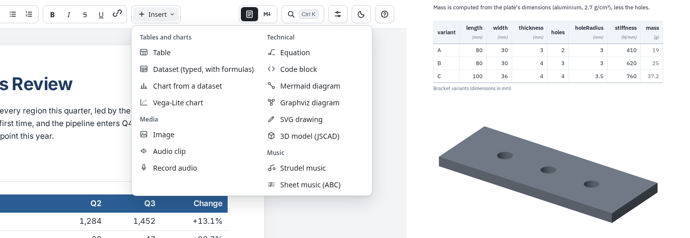
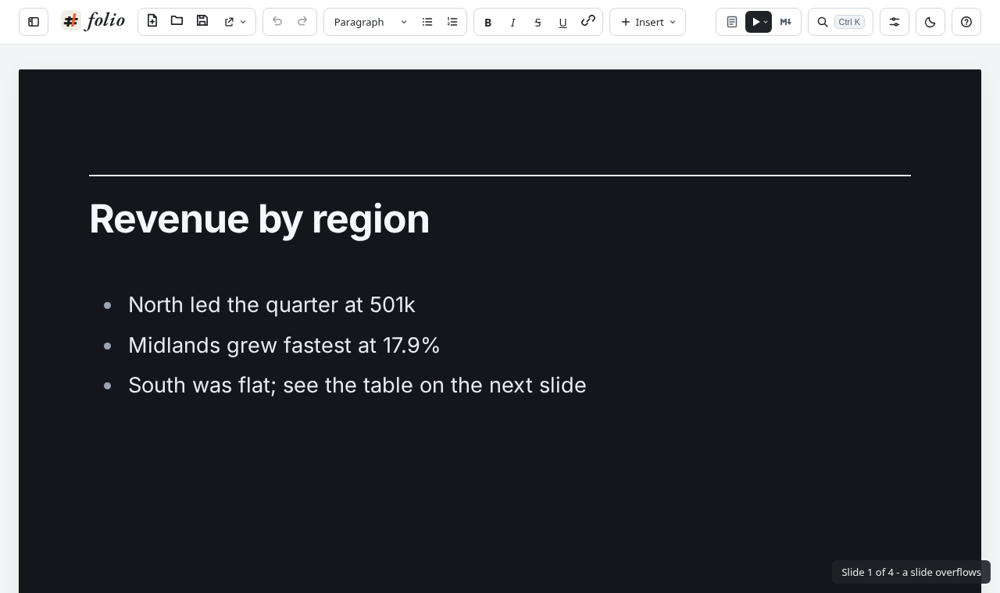

<div align="center">

<h1>
  <picture>
    <source media="(prefers-color-scheme: dark)" srcset="docs/media/wordmark-dark.png">
    
  </picture>
</h1>

**The document Word should have been.**

Write reports where the numbers live in the document and calculate as you
type, the page looks finished from the first word, and the file is plain
text that anyone can read — today, and in twenty years.

**[Try it in your browser](https://tinpotnick.github.io/folio/)** ·
**[Install on Linux, Windows or macOS](#install)** ·
[See the examples](#examples)



</div>

## Why folio

**Your data lives in the document.** A table in folio is a real dataset:
typed columns, units, and formulas that recalculate as you edit. Charts
are drawn from those tables, so when a number changes, every total and
every chart that depends on it changes with it. No pasting screenshots
of spreadsheets, no figures that quietly go out of date.

**Beautiful without trying.** You write headings, paragraphs, tables and
charts; a theme decides the fonts, colours, table rules and chart
palette. There are ten themes, each with a dark mode, and switching
theme restyles the whole document at once. Print or export to PDF and
it looks like a report, not a web page.

**A file you own.** A folio document is one plain Markdown file. Open it
in any text editor, read it on GitHub, keep it in Git, diff it, search
it. No binary format, no account, no lock-in — and folio itself is
open source under the MIT licence. Documents render fully offline.



## What you can do

- **Tables two ways** — a plain Markdown table that GitHub shows as is,
  or a **dataset** with typed columns, units and formulas across rows
  and tables. One click turns one into the other.
- **Charts as queries** — bar, line, area, scatter, pie and donut, with
  several series, stacked or grouped; filter and sort them with the
  same expressions as formulas. Or write a full
  [Vega-Lite](https://vega.github.io/vega-lite/) chart over your data.
- **Equations, code and diagrams** — LaTeX maths, highlighted code,
  Mermaid and Graphviz diagrams, hand-written SVG drawings, and
  parametric **3D models** (JSCAD) you can export as STL.
- **Images, audio and sheet music** — embedded in the document itself;
  record straight from the microphone; write music in ABC notation and
  hear it played.
- **Present as slides** — one click plays any document as a deck: each
  H2 is a full-screen slide, with speaker notes on a separate presenter
  window so the projector stays clean. The file is still plain Markdown.
- **Export to PDF**, print, light and dark mode, a section browser, and
  a command palette (**Ctrl+K**) that finds every action by the words
  you already use.





## It is just Markdown

This is a live dataset and a chart in a folio document — readable, and
diffable, by anyone:

````markdown
::: table {#budget}
caption: "Launch budget"
columns:
  - {name: item, type: text}
  - {name: cost, type: number, unit: "£k"}
  - {name: share, type: formula, expr: "cost / (self.col.cost | sum())", format: percent}
data:
  - [Engineering, 30]
  - [Design, 12]
  - [Marketing, 9]
:::

::: chart {#budget-chart}
source: @budget
query: {select: [item, cost]}
type: donut
:::
````

Everything else — headings, lists, links, ordinary tables — is the
Markdown you already know.

## How it compares

| | folio | Word / Google Docs | Notion | Obsidian | Jupyter / Quarto |
| --- | :---: | :---: | :---: | :---: | :---: |
| Tables that calculate, in the document | ✓ | basic | partly | plugins | ✓ (code) |
| Charts drawn from the document's own data | ✓ | embedded sheets | partly | plugins | ✓ (code) |
| Polished output with no styling by hand | ✓ (themes) | manual | fixed look | themes | templates |
| Plain-text file you can read anywhere | ✓ | — | — | ✓ | ✓ |
| Works offline, no account | ✓ | partly | — | ✓ | ✓ |
| No code to run | ✓ | ✓ | ✓ | ✓ | — |
| Present as slides, with speaker notes on your own screen | ✓ | slides mode | — | — | — |

## Examples

Open any of these in the [web version](https://tinpotnick.github.io/folio/)
(Ctrl+K, then "example"):

- **Q3 Sales Review** — regions, product mix and targets as live charts, a
  heatmap, and the sales pipeline as a diagram.
- **Quarterly review deck** — the same report as a slideshow: press play
  and each section becomes a slide, with a presenter view for your notes.
- **Bracket design review** — a variants table driving a 3D model, mass
  against stiffness, a dimensioned drawing and a requirements trace.
- **A practice journal** — a practice log charted week by week, and
  sheet music you can play.
- **Management accounts**, **Signals and spectra**, **A technical paper**,
  and more.

## Install

**Try it first in your browser:** <https://tinpotnick.github.io/folio/> —
open and save files on your own computer; nothing is uploaded.

### Linux

**Flatpak** — any distribution, sandboxed, updates with your system:
[**Install folio**](https://tinpotnick.github.io/folio/repo/io.github.tinpotnick.folio.flatpakref)
(opens in GNOME Software or KDE Discover), or in a terminal:

```bash
flatpak remote-add --user --if-not-exists flathub https://dl.flathub.org/repo/flathub.flatpakrepo
flatpak remote-add --user --if-not-exists folio https://tinpotnick.github.io/folio/repo/folio.flatpakrepo
flatpak install --user folio io.github.tinpotnick.folio
```

**Fedora** (and other dnf-based systems) — `dnf upgrade` keeps it current:

```bash
sudo dnf config-manager addrepo --from-repofile=https://tinpotnick.github.io/folio/repo/folio.repo
sudo dnf install folio
```

**Debian and Ubuntu** — `apt upgrade` keeps it current:

```bash
sudo install -d -m 0755 /etc/apt/keyrings
curl -fsSL https://tinpotnick.github.io/folio/repo/folio-archive-keyring.gpg \
  | sudo tee /etc/apt/keyrings/folio-archive-keyring.gpg > /dev/null
curl -fsSL https://tinpotnick.github.io/folio/repo/folio.list \
  | sudo tee /etc/apt/sources.list.d/folio.list > /dev/null
sudo apt update && sudo apt install folio
```

Or download the `.AppImage`, `.rpm` or `.deb` from the
[latest release](https://github.com/tinpotnick/folio/releases/latest).

The repositories and packages are signed with folio's key,
fingerprint `6F82 66DF 93E2 5A83 AD43  E40B 089C 758D 9CB4 E587`
([folio-archive-key.asc](packaging/repo/folio-archive-key.asc)).

### Windows and macOS

Download from the [latest release](https://github.com/tinpotnick/folio/releases/latest):
the `.msi` or `-setup.exe` for Windows, the `.dmg` for macOS (Apple
silicon and Intel). The builds are not code-signed yet: on macOS,
right-click the app and choose **Open** the first time; on Windows,
choose **More info → Run anyway** if SmartScreen warns.

folio is young (version 0.1): expect rough edges, and please
[report them](https://github.com/tinpotnick/folio/issues). Your
documents are plain Markdown, so they stay readable whatever happens
to folio.

## Build from source

```bash
npm install
npm run dev            # the web app at http://localhost:5173
npm run dev:desktop    # the desktop app (needs Rust and Tauri's system packages)
```

Tests, the desktop toolchain, and how the project is organised are
in [CONTRIBUTING.md](CONTRIBUTING.md).

## Support folio

folio is free, and made in spare time. If it saves you time or makes
your reports better, you can
[buy me a coffee](https://buymeacoffee.com/tinpotnick) ☕ — or star
the repository and tell someone who writes reports.

## Licence

MIT — see [LICENSE](LICENSE). Bundled fonts, libraries and samples keep
their own licences, listed in [THIRD_PARTY_NOTICES.md](THIRD_PARTY_NOTICES.md).
The optional Strudel live-coding player is AGPL-3.0 and is not part of
folio's builds; folio offers to download it the first time you play a
Strudel pattern.
