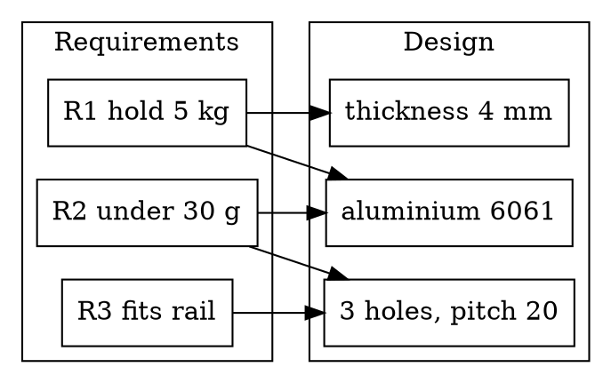

# Mounting Bracket: Design Review

Three variants of the bracket are under review for the sensor rail.
This note compares their mass and stiffness, traces each requirement
to the part, and records the open issues. The model below is drawn
from the variants table: pick a variant in its header to see it, or
export it as STL for a test print.

## Variants

Mass is computed from the plate's dimensions (aluminium,
2.7 g/cm³), less the holes.

::: table {#variants}
caption: "Bracket variants (dimensions in mm)"
columns:
  - {name: variant, type: text}
  - {name: length, type: number, unit: "mm", align: right}
  - {name: width, type: number, unit: "mm", align: right}
  - {name: thickness, type: number, unit: "mm", align: right}
  - {name: holes, type: number, align: right}
  - {name: holeRadius, type: number, unit: "mm", align: right}
  - {name: stiffness, type: number, unit: "N/mm", align: right}
  - {name: mass, type: formula, unit: "g", align: right, expr: "round((length * width - holes * pi * holeRadius * holeRadius) * thickness * 0.0027, 1)"}
data:
  - [A, 80, 30, 3, 2, 3, 410]
  - [B, 80, 30, 4, 3, 3, 620]
  - [C, 100, 36, 4, 4, 3.5, 760]
:::

```jscad params=@variants row=2
const { cuboid, cylinder } = require('@jscad/modeling').primitives
const { subtract } = require('@jscad/modeling').booleans
const { translate } = require('@jscad/modeling').transforms

const getParameterDefinitions = () => [
  { name: 'length', type: 'number', initial: 80 },
  { name: 'width', type: 'number', initial: 30 },
  { name: 'thickness', type: 'number', initial: 4 },
  { name: 'holes', type: 'int', initial: 3 },
  { name: 'holeRadius', type: 'number', initial: 3 },
]

const main = ({ length, width, thickness, holes, holeRadius }) => {
  const plate = cuboid({ size: [length, width, thickness] })
  const pitch = length / (holes + 1)
  const cuts = []
  for (let i = 1; i <= holes; i++) {
    cuts.push(translate(
      [-length / 2 + i * pitch, 0, 0],
      cylinder({ radius: holeRadius, height: thickness + 2, segments: 36 }),
    ))
  }
  return subtract(plate, ...cuts)
}

module.exports = { main, getParameterDefinitions }
```

## Mass against stiffness

The ideal variant is up and to the left: stiff and light. B is the
best compromise; C gains stiffness but weighs nearly half as much
again.

```vega-lite
{
  "data": { "name": "@variants" },
  "layer": [
    {
      "mark": { "type": "point", "filled": true, "size": 120 },
      "encoding": {
        "x": { "field": "mass", "type": "quantitative", "title": "Mass (g)", "scale": { "zero": false, "padding": 24 } },
        "y": { "field": "stiffness", "type": "quantitative", "title": "Stiffness (N/mm)", "scale": { "zero": false, "padding": 24 } }
      }
    },
    {
      "mark": { "type": "text", "dx": 12, "align": "left", "fontSize": 13 },
      "encoding": {
        "x": { "field": "mass", "type": "quantitative" },
        "y": { "field": "stiffness", "type": "quantitative" },
        "text": { "field": "variant" }
      }
    }
  ],
  "height": 220
}
```

## Fixing detail

The bracket clamps to the rail with two M6 bolts; the sketch shows
the critical dimensions.

```svg
<svg xmlns="http://www.w3.org/2000/svg" viewBox="0 0 560 170" width="560">
  <g fill="none" stroke="currentColor" stroke-width="1.6">
    <rect x="40" y="50" width="440" height="70" rx="4"/>
    <circle cx="150" cy="85" r="14"/>
    <circle cx="260" cy="85" r="14"/>
    <circle cx="370" cy="85" r="14"/>
  </g>
  <g stroke="var(--folio-accent)" stroke-width="1" fill="var(--folio-accent)" font-size="13">
    <path d="M40 30 H480 M40 24 V36 M480 24 V36"/>
    <text x="260" y="22" text-anchor="middle" stroke="none">80 mm</text>
    <path d="M500 50 V120 M494 50 H506 M494 120 H506"/>
    <text x="510" y="90" stroke="none">30</text>
    <path d="M150 140 H260 M150 134 V146 M260 134 V146"/>
    <text x="205" y="160" text-anchor="middle" stroke="none">pitch 20</text>
  </g>
</svg>
```

## Requirements trace



## Open issues

| #  | Issue                                   | Owner | Status   |
| -- | --------------------------------------- | ----- | -------- |
| 1  | Confirm M6 clearance on the rail        | DK    | Open     |
| 2  | Fatigue test variant B at 2x load       | AL    | Running  |
| 3  | Anodising colour for the visible face   | DK    | Decided  |

## Actions

1. Select variant B for the pilot build.
   - Print three test parts from the exported STL.
   - Fatigue-test one at twice the rated load.
2. Re-review C if the rail load rises above 6 kg.
