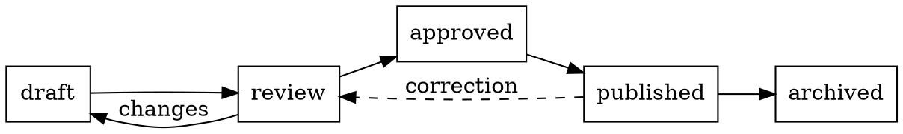
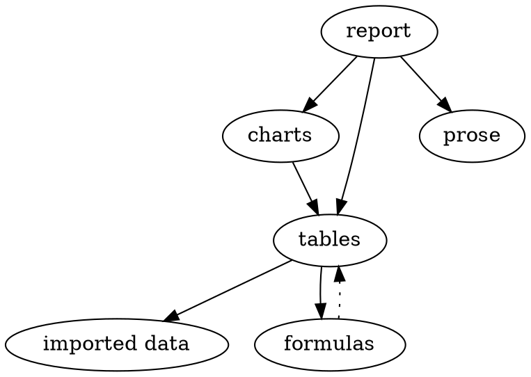

# Drawings from text

Each figure on this page is drawn from a few lines of text in the
document. folio lays it out, draws it in the theme's fonts and
colours, and prints it like any other figure. Click a drawing to see
and edit its source; it redraws as you type. On GitHub, each one is
an ordinary code block.

## Graphviz

[Graphviz](https://graphviz.org) lays out graphs: you list the nodes
and edges, and it decides where everything goes. This is a document's
life, from draft to archive:



A dependency tree, laid out top to bottom:



## Vega-Lite

[Vega-Lite](https://vega.github.io/vega-lite/) describes a chart as
JSON: heatmaps, layers and small multiples that go beyond folio's own
charts. A spec can read a folio dataset by name, so the chart follows
the table. Edit a number below and the heatmap updates.

::: table {#visits}
caption: "Visits by day and time of day"
columns:
  - {name: day, type: text}
  - {name: period, type: text}
  - {name: visits, type: number, align: right}
data:
  - [Mon, morning, 42]
  - [Mon, afternoon, 65]
  - [Mon, evening, 30]
  - [Tue, morning, 48]
  - [Tue, afternoon, 70]
  - [Tue, evening, 34]
  - [Wed, morning, 55]
  - [Wed, afternoon, 81]
  - [Wed, evening, 41]
  - [Thu, morning, 50]
  - [Thu, afternoon, 77]
  - [Thu, evening, 38]
  - [Fri, morning, 39]
  - [Fri, afternoon, 58]
  - [Fri, evening, 61]
:::

```vega-lite
{
  "data": { "name": "@visits" },
  "mark": "rect",
  "encoding": {
    "x": { "field": "day", "type": "ordinal", "sort": null, "title": null },
    "y": { "field": "period", "type": "ordinal", "sort": ["morning", "afternoon", "evening"], "title": null },
    "color": { "field": "visits", "type": "quantitative", "title": "Visits" }
  },
  "height": 140
}
```

The same data, layered: total visits per day, with the weekly average
as a rule.

```vega-lite
{
  "data": { "name": "@visits" },
  "layer": [
    {
      "mark": "bar",
      "encoding": {
        "x": { "field": "day", "type": "ordinal", "sort": null, "title": null },
        "y": { "aggregate": "sum", "field": "visits", "title": "Visits" }
      }
    },
    {
      "transform": [
        { "aggregate": [{ "op": "sum", "field": "visits", "as": "total" }], "groupby": ["day"] }
      ],
      "mark": { "type": "rule", "strokeDash": [4, 3] },
      "encoding": { "y": { "aggregate": "mean", "field": "total" } }
    }
  ]
}
```

## SVG

Sometimes the drawing is simplest to write by hand. An `svg` block
is placed as it is: shapes and text in plain SVG. It takes the page's
ink as `currentColor` and can use the theme's colours
(`var(--folio-accent)`), so it changes with the theme and with dark
mode. Scripts, and anything that would load from the internet, are
removed.

```svg
<svg xmlns="http://www.w3.org/2000/svg" viewBox="0 0 520 140" width="520">
  <g fill="none" stroke="currentColor" stroke-width="1.5">
    <rect x="10" y="40" width="120" height="60" rx="8"/>
    <rect x="200" y="40" width="120" height="60" rx="8"/>
    <rect x="390" y="40" width="120" height="60" rx="8"/>
    <path d="M130 70 H195" marker-end="url(#arrow)"/>
    <path d="M320 70 H385" marker-end="url(#arrow)"/>
  </g>
  <defs>
    <marker id="arrow" viewBox="0 0 10 10" refX="9" refY="5"
            markerWidth="7" markerHeight="7" orient="auto">
      <path d="M0 0 L10 5 L0 10 z" fill="currentColor"/>
    </marker>
  </defs>
  <g font-size="15" text-anchor="middle" fill="currentColor">
    <text x="70" y="75">Write</text>
    <text x="260" y="75">Draw</text>
    <text x="450" y="75" fill="var(--folio-accent)">Publish</text>
  </g>
</svg>
```

## Sheet music

[ABC notation](https://abcnotation.com) writes music as text: one
letter per note, bars marked with `|`. folio engraves it as a score,
and its **Play** button (click the score to show it) sounds it with
folio's own simple synthesizer: offline, nothing downloaded. This is a traditional
reel, *The Silver Spear* (public domain):

```abc
X:1
T:The Silver Spear
R:reel
M:4/4
L:1/8
Q:1/4=150
K:D
A|FA (3AAA BAFA|dfed BddB|FA (3AAA BAFA|dfed BdAd|
FA (3AAA BAFA|dfed BddB|FA (3AAA BAFA|dfed Bd d2||
fa (3aaa bafa|fa (3aaa bafa|fa (3aaa beef|gfed Bd d2|
fa (3aaa bafa|fa (3aaa bafa|fa (3aaa beef|gfed Bd d2|]
```
