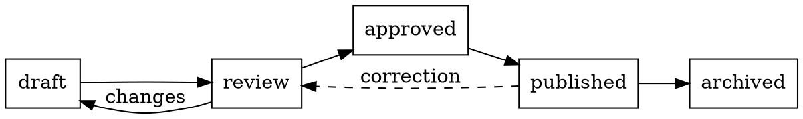
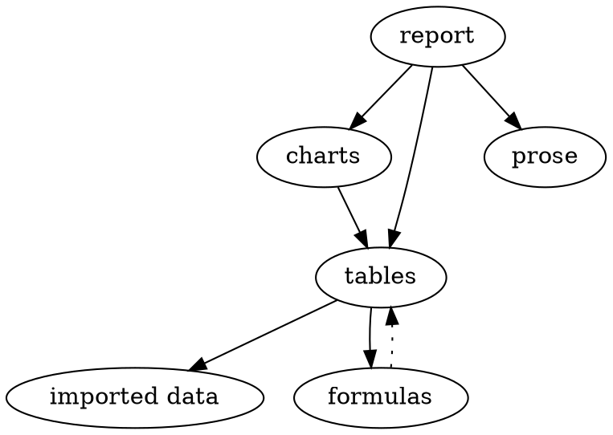

# Drawings from text

Each figure on this page is drawn from a few lines of text in the
document. folio lays it out, draws it in the theme's fonts and
colours, and prints it like any other figure. Click a drawing to see
and edit its source; it redraws as you type. On GitHub, each one is
an ordinary code block.

## Graphviz

[Graphviz](https://graphviz.org) lays out graphs: you list the nodes
and edges, and it decides where everything goes. This is a document's
life, from draft to archive:



A dependency tree, laid out top to bottom:



## Vega-Lite

[Vega-Lite](https://vega.github.io/vega-lite/) describes a chart as
JSON: heatmaps, layers and small multiples that go beyond folio's own
charts. A spec can read a folio dataset by name, so the chart follows
the table. Edit a number below and the heatmap updates.

::: table {#visits}
caption: "Visits by day and time of day"
columns:
  - {name: day, type: text}
  - {name: period, type: text}
  - {name: visits, type: number, align: right}
data:
  - [Mon, morning, 42]
  - [Mon, afternoon, 65]
  - [Mon, evening, 30]
  - [Tue, morning, 48]
  - [Tue, afternoon, 70]
  - [Tue, evening, 34]
  - [Wed, morning, 55]
  - [Wed, afternoon, 81]
  - [Wed, evening, 41]
  - [Thu, morning, 50]
  - [Thu, afternoon, 77]
  - [Thu, evening, 38]
  - [Fri, morning, 39]
  - [Fri, afternoon, 58]
  - [Fri, evening, 61]
:::

```vega-lite
{
  "data": { "name": "@visits" },
  "mark": "rect",
  "encoding": {
    "x": { "field": "day", "type": "ordinal", "sort": null, "title": null },
    "y": { "field": "period", "type": "ordinal", "sort": ["morning", "afternoon", "evening"], "title": null },
    "color": { "field": "visits", "type": "quantitative", "title": "Visits" }
  },
  "height": 140
}
```

The same data, layered: total visits per day, with the weekly average
as a rule.

```vega-lite
{
  "data": { "name": "@visits" },
  "layer": [
    {
      "mark": "bar",
      "encoding": {
        "x": { "field": "day", "type": "ordinal", "sort": null, "title": null },
        "y": { "aggregate": "sum", "field": "visits", "title": "Visits" }
      }
    },
    {
      "transform": [
        { "aggregate": [{ "op": "sum", "field": "visits", "as": "total" }], "groupby": ["day"] }
      ],
      "mark": { "type": "rule", "strokeDash": [4, 3] },
      "encoding": { "y": { "aggregate": "mean", "field": "total" } }
    }
  ]
}
```
