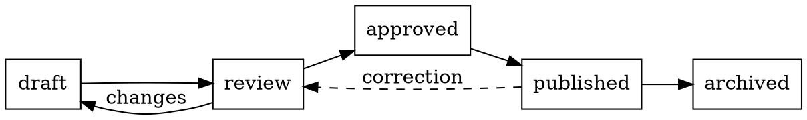
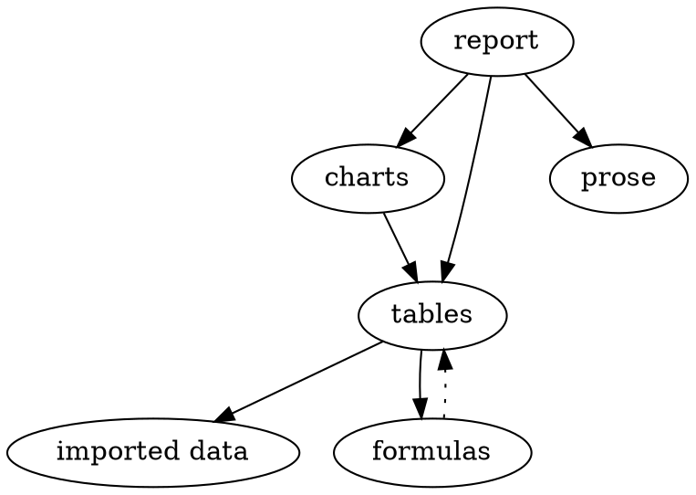

# Drawings from text

Each figure on this page is drawn from a few lines of text in the
document. folio lays it out, draws it in the theme's fonts and
colours, and prints it like any other figure. Click a drawing to see
and edit its source; it redraws as you type. On GitHub, each one is
an ordinary code block.

## Graphviz

[Graphviz](https://graphviz.org) lays out graphs: you list the nodes
and edges, and it decides where everything goes. This is a document's
life, from draft to archive:

A dependency tree, laid out top to bottom:

