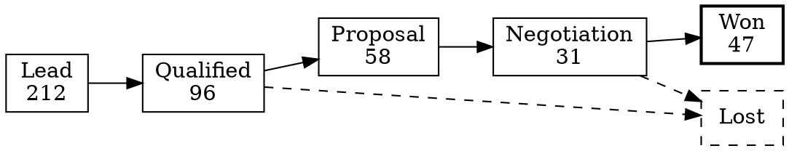

# Q3 Sales Review

Revenue grew in every region this quarter, led by the North. Services
overtook hardware for the first time, and the pipeline enters Q4 with
more qualified deals than at any point this year.

## Summary

| Measure         | Q2     | Q3     | Change |
| --------------- | -----: | -----: | -----: |
| Revenue (£k)    | 1,284  | 1,452  | +13.1% |
| New customers   | 38     | 47     | +23.7% |
| Win rate        | 24%    | 27%    | +3 pts |
| Average deal £k | 33.8   | 30.9   | -8.6%  |

- **Highlights**
  - The North passed its target in every month.
  - Services revenue grew 31% on the quarter.
- **Watch**
  - Average deal size is falling as the mix shifts to smaller,
    recurring services contracts.

## Revenue by region

Monthly revenue, one line per region. The table is in the long form
an export produces (one row per month and region); the chart splits
it by region.

::: table {#regional-revenue}
caption: "Monthly revenue by region (GBP thousands)"
columns:
  - {name: month, type: text}
  - {name: region, type: text}
  - {name: revenue, type: number, unit: "£k", align: right}
data:
  - [Apr, North, 142]
  - [Apr, South, 118]
  - [Apr, Midlands, 96]
  - [May, North, 151]
  - [May, South, 121]
  - [May, Midlands, 99]
  - [Jun, North, 163]
  - [Jun, South, 125]
  - [Jun, Midlands, 104]
  - [Jul, North, 171]
  - [Jul, South, 129]
  - [Jul, Midlands, 112]
  - [Aug, North, 176]
  - [Aug, South, 133]
  - [Aug, Midlands, 118]
  - [Sep, North, 189]
  - [Sep, South, 137]
  - [Sep, Midlands, 125]
:::

::: chart {#region-trend}
source: @regional-revenue
query: {select: [month, revenue]}
type: line
series: region
caption: "Revenue by month and region"
:::

The same table as a heatmap: the North's lead widens month by month,
and the Midlands catch up with the South by September.

```vega-lite
{
  "data": { "name": "@regional-revenue" },
  "mark": "rect",
  "encoding": {
    "x": { "field": "month", "type": "ordinal", "sort": null, "title": null },
    "y": { "field": "region", "type": "nominal", "title": null },
    "color": { "field": "revenue", "type": "quantitative", "title": "£k" }
  },
  "height": 110
}
```

## Product mix

::: table {#product-mix}
caption: "Revenue by product line (GBP thousands)"
columns:
  - {name: month, type: text}
  - {name: hardware, type: number, unit: "£k", align: right}
  - {name: software, type: number, unit: "£k", align: right}
  - {name: services, type: number, unit: "£k", align: right}
  - {name: total, type: formula, unit: "£k", align: right, expr: "hardware + software + services"}
  - {name: share, type: formula, align: right, expr: "services / total", format: percent}
data:
  - [Jul, 168, 96, 148]
  - [Aug, 163, 101, 163]
  - [Sep, 158, 108, 185]
:::

::: chart {#mix-chart}
source: @product-mix
query: {select: [month, hardware, software, services]}
type: bar
stack: true
caption: "Product mix by month - services now the largest line"
:::

## Against target

::: table {#targets}
caption: "Q3 revenue against target (GBP thousands)"
columns:
  - {name: region, type: text}
  - {name: target, type: number, unit: "£k", align: right}
  - {name: actual, type: number, unit: "£k", align: right}
  - {name: variance, type: formula, align: right, expr: "(actual - target) / target", format: percent}
data:
  - [North, 500, 536]
  - [South, 400, 399]
  - [Midlands, 330, 355]
:::

::: chart {#targets-chart}
source: @targets
query: {select: [region, target, actual]}
type: bar
caption: "Target and actual by region"
:::

## Pipeline

Deals move through four stages; lost deals leave from qualification
or negotiation.



## Next quarter

1. Hold the North's pace: two new account managers start in October.
2. Price services bundles to lift the average deal back above £33k.
3. Review the South's flat September before the Q4 forecast.
